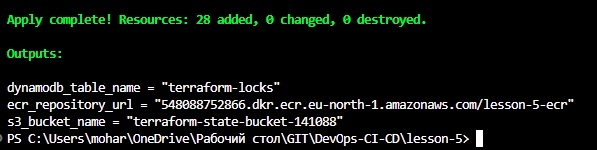

# Lesson 5 — Інфраструктура AWS через Terraform (S3 Backend, VPC, ECR)

Проєкт реалізує базову хмарну інфраструктуру в AWS за допомогою модульного
Terraform: централізоване зберігання та блокування стану (state), мережу VPC із
публічними та приватними підмережами, а також реєстр контейнерних образів ECR.

## Структура проєкту

```text
lesson-5/
│
├── main.tf                  # Головний файл для підключення модулів
├── backend.tf               # Налаштування бекенду для стейтів (S3 + DynamoDB)
├── outputs.tf               # Загальне виведення ресурсів
│
├── modules/                 # Каталог з усіма модулями
│   │
│   ├── s3-backend/          # Модуль для S3 та DynamoDB
│   │   ├── s3.tf            # Створення S3-бакета
│   │   ├── dynamodb.tf      # Створення DynamoDB
│   │   ├── variables.tf     # Змінні для S3
│   │   └── outputs.tf       # Виведення інформації про S3 та DynamoDB
│   │
│   ├── vpc/                 # Модуль для VPC
│   │   ├── vpc.tf           # Створення VPC, підмереж, Internet Gateway
│   │   ├── routes.tf        # Налаштування маршрутизації
│   │   ├── variables.tf     # Змінні для VPC
│   │   └── outputs.tf       # Виведення інформації про VPC
│   │
│   └── ecr/                 # Модуль для ECR
│       ├── ecr.tf           # Створення ECR репозиторію
│       ├── variables.tf     # Змінні для ECR
│       └── outputs.tf       # Виведення URL репозиторію ECR
│
└── README.md                # Документація проєкту
```

## Опис модулів

### `s3-backend`

Відповідає за безпечне зберігання та синхронізацію стану Terraform
(`terraform.tfstate`):

- Створює **S3-бакет** для стейт-файлів із увімкненим **версіонуванням** (для
  збереження історії змін і можливості відкотитися до попередньої версії стану)
  та контролем власності об'єктів.
- Створює таблицю **DynamoDB** із ключем `LockID` для блокування стейту під час
  виконання команд, щоб уникнути конфліктів при паралельних запусках.
- Виводить назву/URL S3-бакета та назву таблиці DynamoDB через `outputs.tf`.

### `vpc`

Відповідає за побудову мережевої інфраструктури в AWS:

- Створює **VPC** із заданим CIDR-блоком (`10.0.0.0/16`).
- Додає **3 публічні** та **3 приватні підмережі** у різних зонах доступності
  (Availability Zones).
- Створює **Internet Gateway** для виходу публічних підмереж в інтернет і **NAT
  Gateway** для виходу приватних підмереж у зовнішню мережу без відкриття їх
  напряму назовні.
- Налаштовує **Route Tables** і асоціації маршрутів для публічних і приватних
  підмереж.

### `ecr`

Відповідає за зберігання Docker-образів у **Amazon ECR**:

- Створює репозиторій ECR із увімкненим автоматичним скануванням образів при
  завантаженні (`scan_on_push = true`).
- Налаштовує політику доступу до репозиторію (`aws_ecr_repository_policy`).
- Виводить URL репозиторію (`repository_url`) через `outputs.tf` для подальшого
  `docker push` / `docker pull`.

## Команди для ініціалізації та запуску

1. **Ініціалізація проєкту, бекенду та провайдерів:** `terraform init`
2. **Перевірка синтаксису та перегляд плану створення/зміни/видалення
   ресурсів:** `terraform plan`
3. **Застосування конфігурації та створення ресурсів в AWS:** `terraform apply`
4. **Видалення всієї створеної інфраструктури (щоб уникнути зайвих витрат в AWS,
   зокрема за NAT Gateway):** `terraform destroy`

> **Примітка:** Якщо перед `terraform destroy` у бакеті стейтів з увімкненим
> версіонуванням зберігаються версії об'єктів, перед видаленням бакета потрібно
> очистити всі версії та delete markers.

## Робота зі станом (локальний стейт → міграція в S3)

Оскільки S3-бакет для стейту створюється цим же кодом Terraform, розгортання
відбувається у два кроки: спочатку інфраструктура піднімається з локальним
стейтом, а потім стан переноситься у віддалений бекенд S3.

### До створення бакета (локальний стейт)

1. Тимчасово закоментуйте блок `backend "s3"` у файлі `backend.tf`.
2. Ініціалізуйте проєкт для локального бекенду:
   ```powershell
   terraform init
   ```

## Результат виконання (`terraform apply`)


